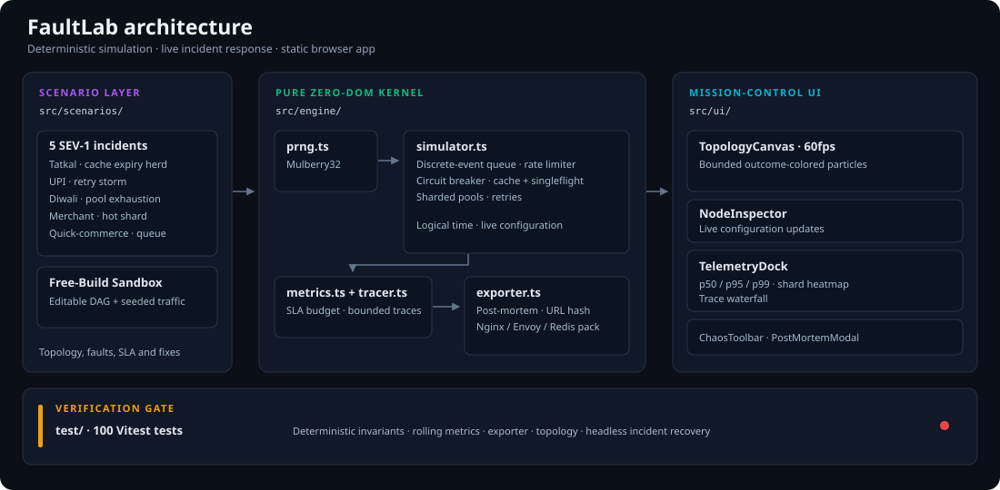

# FaultLab

A deterministic distributed-systems chaos lab for investigating SEV-1 incidents and testing resilience fixes in the browser.

**Live Demo:** [https://faultlab-iota.vercel.app/](https://faultlab-iota.vercel.app/)

<!-- Demo GIF: drop a recording at docs/demo.gif, then uncomment:

-->


## Why FaultLab Exists

- Queue saturation, timeouts and retry amplification interact across service boundaries and are difficult to reason about from a single metric.
- A seeded discrete-event model makes an outage reproducible, so operators can compare changes against the same workload and fault.
- Traces, shard load and latency percentiles expose bottlenecks that cluster averages and aggregate error rates can hide.

## 5 Playable India-Scale SEV-1 Incidents

| Incident | Outage mechanism | Canonical engineering fix |
| --- | --- | --- |
| IRCTC Tatkal 10:00 AM Thundering Herd | Synchronized cache expiry sends duplicate reads to the sharded train database. | Enable singleflight and 20% TTL jitter on Redis. |
| UPI Payment Switch Silent Retry Storm | Immediate retries against a degraded Bank B route occupy switch workers. | Add a Bank B edge circuit breaker, exponential jitter and tighter timeouts. |
| Diwali Flash-Sale Pool Exhaustion | Slow inventory reads occupy primary DB connections and fill checkout queues. | Bound queues, tighten deadlines, tune the DB pool and enable cache offloading. |
| Viral Merchant Hot-Shard Meltdown | A hot merchant concentrates traffic on shard 0 while other shards remain underused. | Enable hot-key cache and singleflight; rate-limit the gateway. |
| Quick-Commerce Queue Backpressure Cascade | Stalled fulfillment backs up the async queue and propagates enqueue failures. | Shed load at the gateway, bound the queue and tune worker concurrency. |

## Interactive Capabilities

- **Free-Build Sandbox** — add and connect nodes, drag the topology and reject cyclic connections with the DAG guard.
- **Five live chaos injectors** — traffic spike, cache flush / TTL storm, latency and error spike, node crash, and hot-key skew.
- **Request waterfall** — inspect completed hop-by-hop traces with queue wait, service time, retries and status in a Datadog / Jaeger-style timeline.
- **Incident response** — inspect live node metrics, change configuration, reveal progressive hints and hold the SLA to resolve an incident.
- **Post-mortem and resilience pack** — export Markdown and topology-derived Nginx, Envoy and Redis/app guidance. The configuration fragments require deployment-specific integration and an upstream.
- **URL hash sharing** — encode a topology, configuration and seed for a fresh tab without a backend.
- **Keyboard shortcuts** — Space plays or pauses, 1–5 select incidents, S opens Sandbox, R resets and Esc closes a modal or exits connect mode.

## Architecture & Simulation Physics



The pure TypeScript engine advances a logical clock through a priority event queue. The UI reads snapshots and applies configuration changes through the simulator API. Scenario definitions supply topologies, faults and SLA targets; tests exercise the engine headlessly.

- **Queueing and Little's Law:** bounded FIFO queues and worker pools make latency and queue depth respond to offered load and service time. Timed-out downstream work can continue occupying a worker.
- **Singleflight:** concurrent misses for the same key can share a backend fetch; TTL jitter spreads expiration across keys.
- **Circuit breakers:** each downstream edge transitions through closed, open and half-open states using observed failures and probes.
- **Retries:** fixed retries or exponential backoff with full jitter are bounded by the configured retry budget.
- **Determinism:** seeded Mulberry32 sampling drives the simulation, making a given seed, topology and sequence of actions reproducible.

## How This Was Built with Codex

The repository's [AGENTS.md](AGENTS.md) sets the engineering guardrails, including a pure zero-DOM engine boundary, seeded randomness and tests for engine rules. The simulator and scenario calibration were built with a Vitest suite covering mathematical invariants, deterministic replay and headless incident recovery. The Git history records the scaffold, engine, scenarios, UI and audit work in focused commits.

## Run Locally & Verify

Requires Node.js and npm.

```sh
npm install
npm run typecheck
npm test
npm run build
npm run dev
```

Open the local URL printed by Vite. The app starts with the Tatkal incident running at 1× speed.
